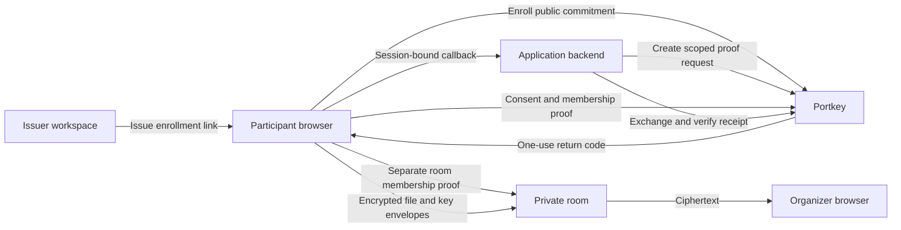

# Architecture and trust boundaries

Portkey has three roles: an issuer publishes an eligibility contract, a participant browser creates or imports a proof, and a relying application decides whether it trusts the exact contract version. The platform supports Semaphore membership and a bounded custom Groth16 BN254 verifier-key adapter. Custom circuit rules are chosen by their issuers; Portkey verifies imported proofs against pinned keys and does not execute uploaded circuits or witnesses. Room admission remains a separate feature that uses the fixed Semaphore membership adapter and credential groups.

The application API key, request state and PKCE verifier stay on the application backend. Semaphore proofs are created in the participant browser. Custom Groth16 proofs are generated locally by the participant using issuer-provided circuit artifacts, then imported into the wallet; the wallet sends a strict proof and public-signal packet, never witness data. Portkey verifies the proof against the version-pinned key, shows declared public signals, and waits for explicit approval before making the result available. It issues a short-lived signed eligibility receipt, which the application backend verifies against its configured issuer, application and exact contract version. A receipt establishes that Portkey accepted the rule; applications must decide whether they trust the issuer and Portkey. Domain verification establishes control of the application's origin, not its legitimacy.

Enrollment links are bearer capabilities until redeemed. The issuer determines who receives one. An enrollment does not establish real-world identity, attendance, uniqueness or the truth of an issuer's claims. The enrollment service sees the invitation and public commitment. Proofs conceal the selected member within the group, but small groups and session or network metadata can identify or correlate participation. A group with one member provides no meaningful anonymity.

Organizer accounts and attendee browser sessions are distinct. Passkey login restores organizer authorization to a stable ownership anchor. Explicit signup can adopt the current guest workspace; signing into an existing account does not merge unrelated guest resources. Recovery replaces passkeys and organizer sessions, while existing resource and recipient identities stay stable.

The participant encrypts file contents and filenames before upload. The server stores ciphertext and separate file-key envelopes for the organizer and original submitter. The organizer's browser holds its private inbox key and performs decryption locally. Restoring account access does not restore that key. An encrypted inbox-key backup restores the key but does not restore authorization. Participant proof credentials are also local browser data.

Room-wide files use a separate browser-generated room secret. The organizer registers only its fingerprint; the full invitation carries the secret in its URL fragment. Admitted browsers import that secret locally. Each shared file has a random content key, authenticated encrypted metadata, immutable encrypted chunks and a complete manifest. The server persists ciphertext, so recipients and later attendees do not need the publisher to remain online. This shared audience is distinct from the private inbox's organizer-and-submitter envelopes. Owner rotation creates a new browser secret and encrypts the earlier key history for it; updated invitations allow historical downloads while old invitations cannot decrypt later files. See [shared-file key rotation](shared-file-key-rotation.md). Losing the room secret requires the original complete invitation; passkey recovery does not recover it. A participant who receives the secret can retain it, so revocation blocks future API access rather than retracting already acquired keys or files.

Browser encryption assumes the intended application code executes. A compromised browser, device or server delivering malicious JavaScript can undermine that assumption. Server-visible metadata includes session relationships, room descriptions, labels, sizes and timing. Optional location checks send coordinates to the server and do not constitute cryptographic proof of physical presence.

Room expiry, account-session expiry, receipt expiry and ciphertext retention are separate policies. Receipt signing keys are database-backed and have an operator rotation procedure; see [signing key rotation](signing-key-rotation.md). Closing or expiring access cannot retract downloaded files. Submission cleanup removes active database records; database backups and copies already saved on participant devices have their own retention. Deployment and backup responsibilities are described in [operations](operations.md).

See [the demo walkthrough](demo.md) for the complete room and Semaphore user journey, [the verification protocol](verification-platform.md) for application integration, and [proof adapters](proof-adapters.md) for custom Groth16 rules and limitations.
