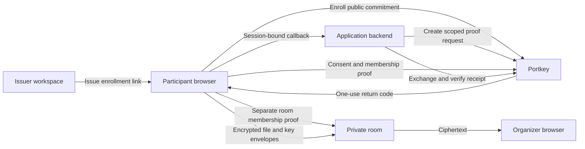

# Architecture and trust boundaries

Portkey has three roles: an issuer enrolls eligible participants, a participant browser holds the credential secret, and a relying application decides whether it trusts a published eligibility contract. An organizer can also use that contract's credential groups to admit participants to a room. The supported proof adapter establishes membership in selected Semaphore groups.

The application API key, request state and PKCE verifier stay on the application backend. The participant browser creates a proof locally. Portkey verifies the proof and issues a short-lived signed eligibility receipt, which the application backend verifies against its configured issuer, application and exact contract version. A receipt establishes that Portkey accepted the rule; applications must decide whether they trust the issuer and Portkey. Domain verification establishes control of the application's origin, not its legitimacy.

Enrollment links are bearer capabilities until redeemed. The issuer determines who receives one. An enrollment does not establish real-world identity, attendance, uniqueness or the truth of an issuer's claims. The enrollment service sees the invitation and public commitment. Proofs conceal the selected member within the group, but small groups and session or network metadata can identify or correlate participation. A group with one member provides no meaningful anonymity.

Organizer accounts and attendee browser sessions are distinct. Passkey login restores organizer authorization to a stable ownership anchor. Explicit signup can adopt the current guest workspace; signing into an existing account does not merge unrelated guest resources. Recovery replaces passkeys and organizer sessions, while existing resource and recipient identities stay stable.

The participant encrypts file contents and filenames before upload. The server stores ciphertext and separate file-key envelopes for the organizer and original submitter. The organizer's browser holds its private inbox key and performs decryption locally. Restoring account access does not restore that key. An encrypted inbox-key backup restores the key but does not restore authorization. Participant proof credentials are also local browser data.

Browser encryption assumes the intended application code executes. A compromised browser, device or server delivering malicious JavaScript can undermine that assumption. Server-visible metadata includes session relationships, room descriptions, labels, sizes and timing. Optional location checks send coordinates to the server and do not constitute cryptographic proof of physical presence.

Room expiry, account-session expiry, receipt expiry and ciphertext retention are separate policies. Closing or expiring access cannot retract downloaded files. Submission cleanup removes active database records; database backups and copies already saved on participant devices have their own retention. Deployment and backup responsibilities are described in [operations](operations.md).

See [the demo walkthrough](demo.md) for the complete user journey and [the verification protocol](verification-platform.md) for application integration details.
